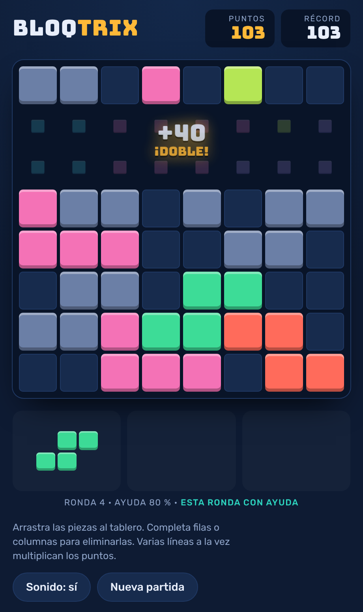

# BLOQTRIX

> A block puzzle on an 8×8 board. Drag pieces in, complete rows or columns to clear them, chain combos.
> One HTML file, no dependencies, no build step. Built with Claude Code.

**[▶ Play it in your browser](https://gabicuesta.github.io/bloqtrix/)** · works on desktop and mobile · UI in Spanish

🇪🇸 [Versión en español más abajo](#-en-español)

  

## How to play

- Drag any of the three pieces onto the board. Pieces don't rotate.
- Fill a full row or column to clear it. Each placed cell scores 1 point.
- Clearing several lines at once multiplies the reward: `10 × lines²` (single +10, double +40, triple +90…).
- When none of the remaining pieces fits, the game is over. Your best score is saved in the browser.

## What's interesting under the hood

**A dealer that keeps the game fair, not just random.** Pure random trays end games unfairly: three pieces that
can't all fit. Before dealing, the game can run a small solver that searches every order and position to check
that the three pieces fit *together*, and measures how forgiving the tray is: the share of first moves that still
leave room for the other two. If the board is tight, it swaps in small helper pieces (single cell, bar of two,
diagonals) until the tray is playable.

| Round | Assisted deal |
|---|---|
| 1–3 | Always, with at least 90% of first moves forgiving |
| 4+ | 80% chance, down 3 points per round to a 20% floor, 75% forgiving |

The line under the tray shows the round and the current assist level, as a tuning aid. All parameters live in
one `ASSIST` object.

**Sound without audio files.** Every effect is synthesised with the Web Audio API: a dull thud when a piece lands,
a rising pentatonic chime per cleared line, a start fanfare, and a sad-trombone *wah-wah-waaah* on game over.

**Small and readable.** About 800 lines of HTML, CSS and vanilla JavaScript. The piece catalogue is declarative
(`'#'` = filled, `'.'` = empty), so adding a new piece is one line. Respects `prefers-reduced-motion`, works with
mouse and touch (on touch, the piece floats above your finger so you can see where it lands).

## Run it locally

Open `index.html` in any modern browser. That's it.

## How it was made

Designed and iterated with **Claude Code**: game rules, the fair-dealing solver, the synthesised sound effects and
the tuning of the difficulty curve, playtesting between iterations. A small example of going from idea to a
polished, playable game in a few sessions.

## License

MIT.

---

## 🇪🇸 En español

**BLOQTRIX** es un puzzle de bloques en un tablero de 8×8: arrastra las piezas, completa filas o columnas para
eliminarlas y encadena combos. Es un único archivo HTML, sin dependencias. **[Juega aquí](https://gabicuesta.github.io/bloqtrix/)**.

- **Puntuación:** 1 punto por casilla colocada y `10 × líneas²` al eliminar líneas (doble +40, triple +90…).
- **Reparto justo:** antes de repartir, un pequeño solver comprueba que las tres piezas caben juntas y cuántas
  primeras jugadas dejan sitio a las otras dos. Si el tablero está apretado, mete piezas de ayuda. La ayuda es
  total las tres primeras rondas y luego va bajando del 80 % al 20 %.
- **Sonido sintetizado** con Web Audio, sin archivos: golpe al encajar, arpegio por línea y trombón triste al perder.
- Funciona con ratón y pantalla táctil, y respeta la preferencia de reducir animaciones.

Hecho con **Claude Code**, de la idea al juego terminado en pocas sesiones.
