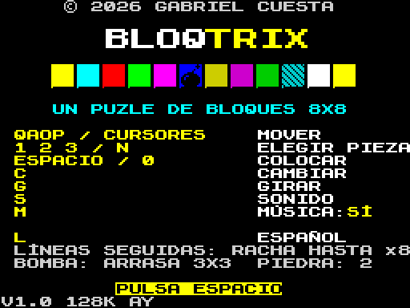
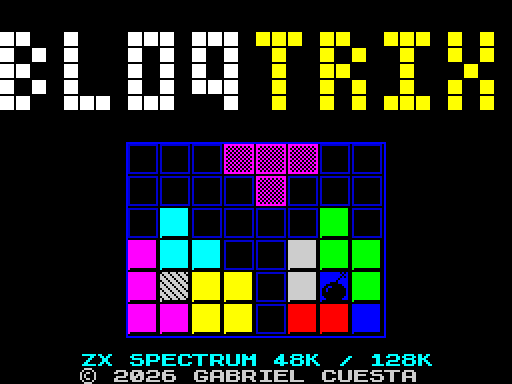
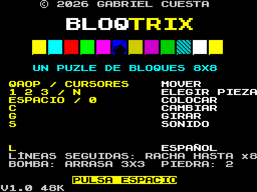
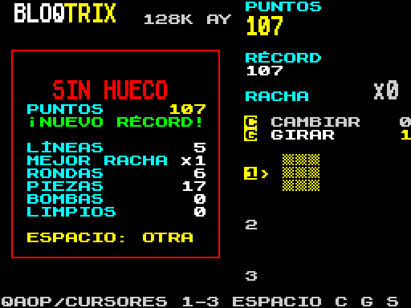

# BLOQTRIX para ZX Spectrum

> El puzle de bloques de 8×8 de la versión web, portado al ZX Spectrum en C con z88dk.
> Dos variantes: **48K** con el *beeper* y **128K** con el chip de sonido AY y música. En español y en inglés.

🇬🇧 [English summary below](#-english)

<p align="center">
  
</p>
<p align="center">
  
  
  
</p>

## Archivos para jugar

| Archivo | Máquina | Sonido |
|---|---|---|
| `build/bloqtrix48.tap` / `build/bloqtrix48.sna` | Spectrum 48K (y cualquier modelo superior) | Beeper |
| `build/bloqtrix128.tap` / `build/bloqtrix128.sna` | Spectrum 128K y +2 (en +2A/+3 debería funcionar, sin probar) | Chip AY: efectos y música |

- **`.sna`** (instantánea): carga al momento en cualquier emulador (Fuse, ZEsarUX, Spectaculator, JSSpeccy…).
- Los `.tap` llevan pantalla de carga. Las instrucciones en texto plano están en [INSTRUCCIONES.txt](INSTRUCCIONES.txt) y [INSTRUCTIONS.txt](INSTRUCTIONS.txt).
- **`.tap`** (cinta): para emulador o para un Spectrum real (con un lector de tarjetas tipo divMMC o pasándolo
  a audio). En el 48K, `LOAD ""`; en el 128K, la opción *Tape Loader* del menú.

## Controles

| Tecla | Acción |
|---|---|
| `Q` `A` `O` `P` o cursores (`5` `6` `7` `8`) | Mover la pieza por el tablero |
| `1` `2` `3` o `N` | Elegir pieza (o pasar a la siguiente) |
| `ESPACIO`, `ENTER` o `0` | Colocar |
| `C` | Cambiar: sustituye las piezas que quedan por otras que caben |
| `G` | Girar 90° la pieza elegida |
| `S` | Sonido sí/no |
| `M` | Música sí/no (128K) |
| `L` (en el título) | Idioma: español / inglés |
| **Kempston** | Mover con la palanca y colocar con el disparo. Para cambiar de pieza, mantén el disparo y mueve a izquierda o derecha |

## Reglas (las mismas que en la web)

- Cada ronda trae 3 piezas. Completa filas o columnas para eliminarlas.
- **Puntos:** 1 por casilla colocada y `10 × líneas² × racha` al hacer líneas.
- **Racha:** si haces línea en jugadas seguidas, el multiplicador sube hasta x8. Si colocas una pieza sin hacer línea, vuelve a 0.
- **Ayudas:** empiezas con 1 *Cambiar* y 1 *Girar*. Ganas un *Cambiar* cada vez que la racha llega a 3, 6, 9… y
  al dejar el tablero vacío. Ganas un *Girar* cada 8 líneas. Puedes guardar hasta 3 de cada.
- **Bonus:** +100 por una línea entera de un solo color y +300 por dejar el tablero vacío.
- **Bombas** (desde la ronda 2): al eliminarse su línea, arrasan su zona de 3×3. Si alcanzan otra bomba, explotan en cadena.
- **Piedra** (desde la ronda 5): la primera línea solo la agrieta; la segunda la rompe.
- **Reparto justo:** igual que en la web, las tres primeras rondas siempre traen piezas que caben. Después,
  la ayuda va bajando del 80 % al 20 %.
- La partida acaba cuando ninguna pieza cabe y no te quedan ayudas que lo arreglen. La pantalla final muestra
  líneas, mejor racha, rondas, piezas, bombas y tableros limpios.

## Cómo está hecho

**El tablero encaja con el hardware.** El Spectrum colorea la pantalla en bloques de 8×8 píxeles. Cada casilla
mide 16×16 (2×2 bloques) y tiene un único color, así que nunca aparece el típico choque de colores. La sombra de la
pieza es una trama de puntos, y las líneas que vas a completar parpadean con el atributo `FLASH` del propio ULA.

**El reparto con ayuda cabe en un Z80 a 3,5 MHz.** Es el mismo algoritmo de la web: comprueba que las tres piezas
caben juntas en algún orden y mide cuántas primeras jugadas dejan sitio a las demás. Para que sea rápido:
- El tablero se guarda como 8 bytes, uno por fila.
- La comprobación de en qué columnas cabe una pieza es una rutina en ensamblador que usa una tabla precalculada de
  2 KB (`dil`, alineada a 256 bytes para indexarla con un solo byte).
- La búsqueda tiene un límite de trabajo por reparto.

Así, repartir tarda unos 0,1 s en un tablero normal y no pasa de unos 0,25 s en los más apretados, medido en ciclos
con `z88dk-ticks` (`tools/bench.c`).

**Sonido.**
- En el **48K**, dos rutinas en ensamblador generan un tono exacto y un ruido blanco (LFSR) por el altavoz.
  Con ellas se hacen el golpe al colocar, el arpegio por línea (más agudo con la racha), la explosión, la
  fanfarria y el trombón triste del final.
- En el **128K**, un reproductor dentro de la interrupción de 50 Hz controla el AY:
  - Canal A: la melodía.
  - Canal B: el bajo y los efectos musicales.
  - Canal C: los golpes y los ruidos.

  Los efectos se ponen en cola y suenan mientras el juego sigue.

**Memoria (las dos variantes):**

| Dirección | Contenido |
|---|---|
| `0x8000` | Código y datos (unos 21 KB) |
| hasta `0xF3FF` | Pila |
| `0xF400` | Tabla del motor |
| `0xFC00` | Tabla de vectores IM 2 |

La fuente es la del ROM en negrita, con É Í Ó Á Ú Ñ ¡ ¿ añadidas.

## Compilar

Necesitas [z88dk](https://github.com/z88dk/z88dk) 2.4 (con `zcc` en el `PATH` y `ZCCCFG` apuntando a `lib/config`)
y Node.js (genera la tabla de notas):

```bash
./build.sh
```

Crea `build/bloqtrix48.{tap,sna}` y `build/bloqtrix128.{tap,sna}`.

Para publicar, `JSSPECCY=/ruta/a/jsspeccy-3.x tools/make_release.sh` crea en `release/` el paquete de descarga y el
de juego en el navegador para itch.io.

## Estructura

| Archivo | Qué hace |
|---|---|
| `src/engine.c` | Tablero, piezas, líneas, bombas, piedra y reparto con ayuda (sin dependencias del hardware) |
| `src/gfx.c` | Pantalla, atributos, fuente y dibujos de las casillas |
| `src/sound48.c` / `src/sound128.c` | Sonido del beeper / del chip AY |
| `src/main.c` | Interrupción, teclado y Kempston, título, partida y pantalla final |
| `src/lang.h` | Todos los textos en español e inglés |
| `assets/loading.scr` | Pantalla de carga (la genera `tools/make_loading.js`) |
| `itch/index.html` | Página para jugar en el navegador en itch.io (con el emulador JSSpeccy 3) |
| `tools/make_cover.js` | Portada de 630×500 para itch.io (`docs/cover.png`) |
| `tools/make_release.sh` | Monta los paquetes de publicación en `release/` |
| `tools/gen_notes.js` | Genera `src/notes.h` (frecuencias para beeper y AY) |
| `tools/bench.c`, `tools/test_fits.c` | Medición de ciclos del reparto y prueba de la rutina en ensamblador (objetivo `+test` de z88dk) |

---

## 🇬🇧 English

A ZX Spectrum port of BLOQTRIX, written in C with z88dk.
- **48K build:** beeper sound effects.
- **128K build:** AY sound effects plus music.

**Load:** `.sna` snapshots load instantly in any emulator; `.tap` files (with a loading screen) work on real hardware.
Instructions: [INSTRUCTIONS.txt](INSTRUCTIONS.txt).

**Controls:**
- **Move:** QAOP or cursor keys.
- **Choose piece:** 1–3 or N.
- **Place:** SPACE, ENTER or 0.
- **Swap:** C. **Rotate:** G.
- **Sound:** S. **Music (128K):** M.
- **Language:** L on the title screen (Spanish / English).
- **Kempston:** supported.

**Gameplay:** the same rules as the web version.
- Streak multiplier up to x8, earnable Swap and Rotate powers.
- Single-colour line and clean-board bonuses.
- Bombs that clear 3×3 and chain, stone cells that need two lines.

**Fair dealing:** the dealer from the web version runs on the 3.5 MHz Z80 thanks to bitboard rows and a hand-written
assembly fit check. A deal takes about 0.1 s on a typical board.

**Build:** `./build.sh` (needs z88dk 2.4 and Node.js).
